# Macropad Hardware and Wiring

This document records the hardware connections used by the ESP32-S3 firmware in [`firmware/keys_shorcuts/keys_shorcuts.ino`](../firmware/keys_shorcuts/keys_shorcuts.ino). GPIO assignments below are taken from that firmware.

## Controller

- **Controller:** ESP32-S3 DevKit

## 3×3 key matrix

The matrix has three row signals and three column signals. Each of the nine switches has exactly one 1N4148 diode in series with it. The firmware wiring direction is **row → switch → diode anode → diode cathode → column**. The diode’s cathode is the striped end and faces the column.

The row signal is fanned out to the row’s three switch-and-diode branches. These branches are connected in parallel on the row side, with each branch ending at its own column. A row trace and a column trace crossing in the diagram are not electrically connected just because they cross. At each of the nine switch positions, the row and column are connected only through that position’s switch and diode.

The nine crossings are:

| Matrix crossing | Switch | Row GPIO | Column GPIO |
|---|---:|---:|---:|
| Row 1 × Column 1 | SW1 | GPIO 13 | GPIO 38 |
| Row 1 × Column 2 | SW2 | GPIO 13 | GPIO 37 |
| Row 1 × Column 3 | SW3 | GPIO 13 | GPIO 36 |
| Row 2 × Column 1 | SW4 | GPIO 12 | GPIO 38 |
| Row 2 × Column 2 | SW5 | GPIO 12 | GPIO 37 |
| Row 2 × Column 3 | SW6 | GPIO 12 | GPIO 36 |
| Row 3 × Column 1 | SW7 | GPIO 11 | GPIO 38 |
| Row 3 × Column 2 | SW8 | GPIO 11 | GPIO 37 |
| Row 3 × Column 3 | SW9 | GPIO 11 | GPIO 36 |

The diagram is embedded below. Its circuit artwork and switch/diode labels are preserved from the supplied SVG; its three column GPIO labels are corrected to match the firmware assignments above.

## Rotary encoder

| Encoder signal | ESP32-S3 GPIO |
|---|---:|
| CLK | GPIO 7 |
| DT | GPIO 41 |
| SW (push button) | GPIO 6 |

## OLED

- **Display:** SSD1306, 128×64, monochrome I²C
- **I²C address:** `0x3C`; some modules use `0x3D`

## Pin assignments

| Signal | ESP32-S3 GPIO | Connected component |
|---|---:|---|
| Matrix ROW 1 | GPIO 13 | Row 1 bus: SW1, SW2, SW3 branches |
| Matrix ROW 2 | GPIO 12 | Row 2 bus: SW4, SW5, SW6 branches |
| Matrix ROW 3 | GPIO 11 | Row 3 bus: SW7, SW8, SW9 branches |
| Matrix COL 1 | GPIO 38 | Column 1 branches: SW1, SW4, SW7 |
| Matrix COL 2 | GPIO 37 | Column 2 branches: SW2, SW5, SW8 |
| Matrix COL 3 | GPIO 36 | Column 3 branches: SW3, SW6, SW9 |
| Encoder CLK | GPIO 7 | Rotary encoder clock output |
| Encoder DT | GPIO 41 | Rotary encoder direction output |
| Encoder SW | GPIO 6 | Rotary encoder push-button output |
| OLED SDA | GPIO 4 | SSD1306 I²C data |
| OLED SCL | GPIO 5 | SSD1306 I²C clock |
